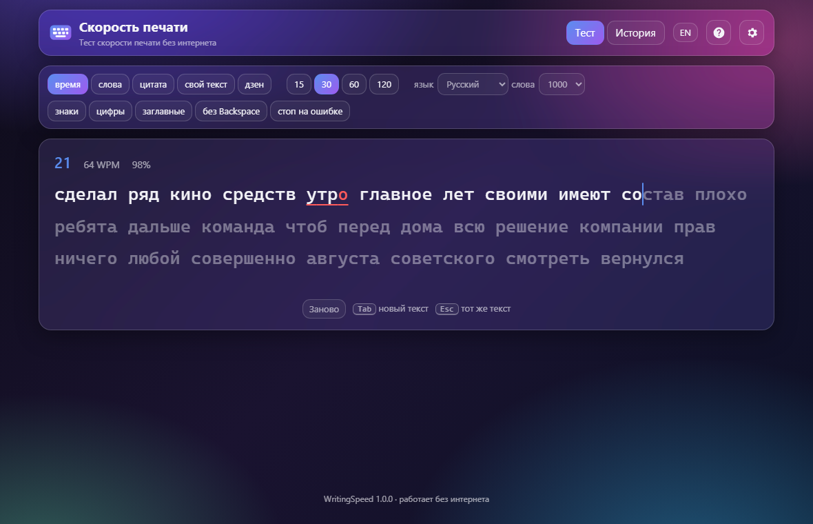
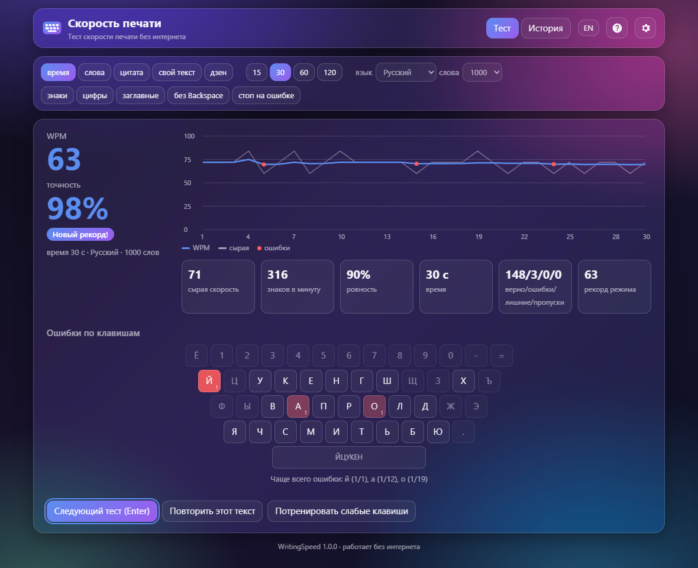
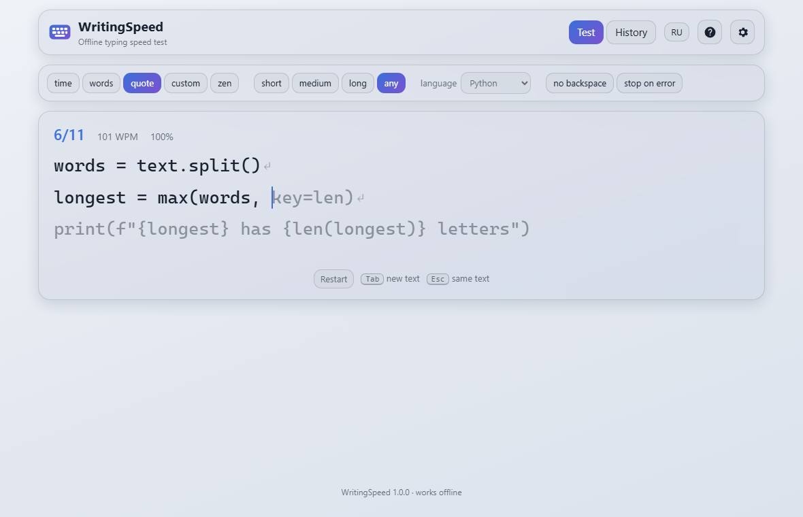
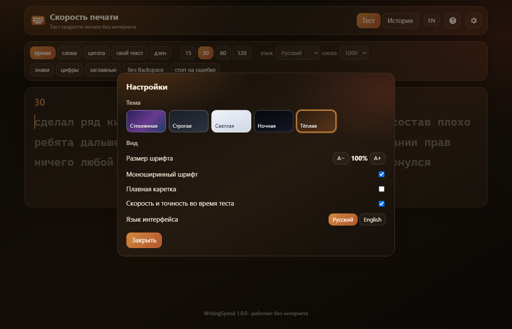

# WritingSpeed

**English** · [Русский](README.ru.md)

**WritingSpeed** («Скорость печати») is a typing speed test in a single HTML page. It works with no server and no internet: open `index.html`, use it online, or install the Windows app.

**[▶ Try it online](https://alexalesha.github.io/WritingSpeed/)** · **[⬇ Windows app (setup and portable)](https://github.com/ALEXalesha/WritingSpeed/releases/latest)**

The interface is in Russian and English (the RU/EN button in the header).





## What it can do

- **Modes:** time (15, 30, 60, 120 s; type words or connected text), words (10, 25, 50, 100), text (~10, ~20, ~50, ~100, ~200, ~300 words: classic passages and original texts, 10 per length and language), custom text, and zen - no text and no limit, Shift+Enter to finish. A long word without spaces wraps across lines.
- **Languages:** Russian, Ukrainian, English, German, French, Spanish, Chinese, and code - JavaScript and Python (keywords and snippets; a new line is Enter, the indent is not typed).
- **Dictionary:** test words come from the 200, 1000 or 5000 most frequent words of the language (fewer is easier).
- **Chinese:** characters through an input method (IME) - nothing counts while pinyin is being composed, the result is checked by characters; speed is characters per minute, mistakes are listed by character. There is a "pinyin in Latin letters" mode (you type pinyin, the characters are shown above) and a pinyin hint above the characters. Text lengths are ~20...~600 characters.
- **Difficulty:** punctuation, numbers, capitals; "no backspace" (nothing can be erased) and "stop on error" (a wrong letter is not typed until you press the right one).
- **Statistics:** net WPM and CPM, raw speed, accuracy, consistency, correct/wrong/extra/missed characters, a speed graph by second with the mistakes on it, mistakes by key on the keyboard of the test language (ЙЦУКЕН, Ukrainian, QWERTY, QWERTZ, AZERTY, Spanish), weakest keys and a practice test made of words with them.
- **Records** for every mode (mode, language, list and difficulty) and a history of the last 200 tests, kept in the browser (`localStorage`, keys `typing:*`); the page keeps working if the storage is blocked.
- **Typing feel:** a smooth caret, correct and wrong letters coloured as you type, a shake on a blocked key, a hint "switch the keyboard layout" when Latin letters come in a Russian test (and the other way round).
- **Look:** five themes (Glass, Formal, Light, Night, Warm - the same as in Paint Pro and Calc Pro), font size 75-200%, monospace or proportional font.





### How it is counted

| Value | Formula |
|---|---|
| WPM (net) | characters of correctly typed words + the spaces after them, / 5, / minutes |
| CPM | the same characters per minute |
| Raw speed | every keypress that typed a character (erased ones too), / 5, / minutes |
| Accuracy | correct keypresses / all keypresses × 100% |
| Consistency | 100 × (1 − tanh(v + v³/3 + v⁵/5)), v = standard deviation / mean of the speed by second |

Time runs from the first keypress to the last (in time mode - exactly the chosen limit). A mistake is counted on the key you should have pressed.

### Which settings each mode shows

Only the settings that change the current mode are shown; a hidden setting is kept and comes back with its mode.

| Mode | Shown |
|---|---|
| time + words | time, words/text, language, dictionary, punctuation, numbers, capitals, no backspace, stop on error |
| time + text | time, words/text, language, no backspace, stop on error |
| words | word count, language, dictionary, punctuation, numbers, capitals, no backspace, stop on error |
| text | length, language, no backspace, stop on error |
| custom | edit, no backspace, stop on error |
| zen | no backspace |

For Chinese, "input" (characters or pinyin) and "pinyin above characters" replace punctuation, numbers and capitals; code has no dictionary, punctuation, capitals or words/text choice.

### Keys

| Key | Action |
|---|---|
| Tab | new text (custom: the new-text window; zen: erase what you typed) |
| Esc | the same text again (zen: start over) |
| Ctrl+Backspace | erase a word |
| Enter (on results) | next test |
| Shift+Enter | finish a zen test |

## Run locally

- **Browser:** open `index.html` in Chrome, Edge or Firefox. Everything is in the file; nothing is downloaded.
- **Windows app:** take `WritingSpeed-<version>-Setup.exe` (installs for the current user) or `WritingSpeed-<version>-Portable.exe` (runs without installing) from [Releases](https://github.com/ALEXalesha/WritingSpeed/releases). The window remembers its size and place; the version is in the title.
- **From source:** `npm install`, then `npm start` (the app) or `npm run dist` (setup and portable in `electron/dist`).

The app in `electron/` loads the same `index.html` - there is no second copy of the page.

## Tests

```
npm install
npx playwright install chromium
npm test                       # page laws (fake clock) and the Electron app (hidden window)
npm run test:unit              # app laws without starting it
node tests/mutate.js           # mutation check: broken copies of the page must fail the laws
```

The page laws open `index.html` by its file address in headless Chromium, one at a time, with a fake clock (`page.clock`): a known text typed at a known pace must give exactly the expected WPM, accuracy and mistakes by key. The mutation check breaks 20 rules one by one (the WPM formula, accuracy, consistency, time limit, records, storage, …) in a copy in a temporary folder and never touches `index.html`. The Electron test runs the app with a hidden, non-focusable window. Mouse capture in the tests is always a stub. The pictures above were made headless by `tools/screenshots.js`.

## Where the words and texts come from

- **Word lists** (the `WORDS` block of `index.html`) are built by `tools/make-words.py` from word frequencies of **[wordfreq](https://github.com/rspeer/wordfreq) 3.1.1** by Robyn Speer et al. (data: Wikipedia, subtitles, books, news and more; licence **CC BY-SA 4.0**). Each word is kept only if the Hunspell dictionary of its language ([wooorm/dictionaries](https://github.com/wooorm/dictionaries)) knows it in that spelling - this drops names, places, abbreviations and words of other languages; rude words are removed by the patterns in `tools/blocklist.b64.txt` (base64, so the file is not readable at a glance). German nouns keep their capital letter. **The `WORDS` block is licensed under CC BY-SA 4.0**; the rest of the page is MIT.
- **Texts** (the `TEXTS` block, built by `tools/make-texts.py` from `tools/texts/<lang>.txt`) are public domain (Pushkin, Tolstoy, Lermontov, Gogol, Krylov, Tyutchev, Nekrasov, Yesenin, Blok, Shevchenko, Lesya Ukrainka, Franko, Kotliarevsky, Shakespeare, Austen, Carroll, Keats, Blake, Melville, Dickinson, Lincoln, Goethe, Schiller, Heine, Kafka, Rilke, Eichendorff, the Brothers Grimm, Hugo, Descartes, Proust, La Fontaine, Voltaire, Verlaine, Baudelaire, Corneille, Molière, Rousseau, Pascal, Lamartine, Cervantes, Machado, Bécquer, Calderón, Darío, Espronceda, Quevedo, Confucius, Laozi, Xunzi), proverbs, pangrams, or original texts written for this project. Code snippets are original.
- **Chinese:** words come from wordfreq (simplified characters), texts are split into words by [jieba](https://github.com/fxsjy/jieba) 0.42.1 (MIT), toneless pinyin by [pypinyin](https://github.com/mozillazg/python-pinyin) 0.55.0 (MIT). The font is a system Chinese font (Microsoft YaHei, Noto Sans SC, PingFang SC and others); nothing is downloaded.

## History

WritingSpeed was made in the [GameRoom](https://github.com/ALEXalesha/GameRoom) collection (folder `web/writing-speed`), where it is the first program in the "Programs" section of the Igroteka launcher ([open there](https://alexalesha.github.io/GameRoom/)). This repository carries it with its commit history.

## Licence

Code: MIT, see [LICENSE](LICENSE). The word lists in the `WORDS` block: CC BY-SA 4.0 (derived from wordfreq).
