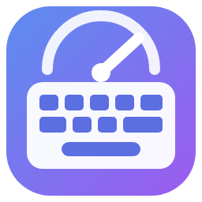

<div align="center">



# WritingSpeed

**«Скорость печати» (WritingSpeed) - тест скорости печати одной страницей HTML. Работает без сервера и без интернета: откройте `index.html`, пользуйтесь на сайте или поставьте программу для Windows.**

[**▶ Открыть на сайте →**](https://alexalesha.github.io/WritingSpeed/) &nbsp;·&nbsp; [Скачать для Windows](https://github.com/ALEXalesha/WritingSpeed/releases/latest) &nbsp;·&nbsp; [English version of this file](README.md)

[](#) [](https://github.com/ALEXalesha/WritingSpeed/releases/latest) [](https://github.com/ALEXalesha/WritingSpeed/actions/workflows/ci.yml) [](LICENSE) [](https://developer.mozilla.org/docs/Web/HTML) [](https://www.electronjs.org/) [](https://alexalesha.github.io/WritingSpeed/) [](https://claude.com/claude-code)

Код, тесты и документация этого проекта написаны Claude (Anthropic) в Claude Code. Идеи, проверка и решения - Алексей.

</div>

Интерфейс на русском и английском (кнопка RU/EN в шапке).


## Что умеет

- **Режимы:** время (15, 30, 60, 120 с; печатать слова или связный текст), слова (10, 25, 50, 100), текст (~10, ~20, ~50, ~100, ~200, ~300 слов: отрывки классиков и свои тексты, по 10 на каждую длину и язык), свой текст и дзен - без текста и без предела, Shift+Enter - закончить. Длинное слово без пробелов переносится по строкам.
- **Языки:** русский, украинский, английский, немецкий, французский, испанский, китайский и код - JavaScript и Python (ключевые слова и отрывки; новая строка - Enter, отступ печатать не надо).
- **Словарь:** слова теста берутся из 200, 1000 или 5000 самых частых слов языка (меньше - проще).
- **Китайский:** иероглифы через метод ввода (IME) - пока набирается пиньинь, ничего не засчитывается, итог сверяется по иероглифам; скорость - иероглифов в минуту, ошибки - списком по иероглифам. Есть режим «пиньинь латиницей» (печатается пиньинь, иероглифы - над ним) и подсказка-пиньинь над иероглифами. Длины текста - ~20...~600 иероглифов.
- **Сложность:** знаки препинания, цифры, заглавные; «без Backspace» (стирать нельзя) и «стоп на ошибке» (неверная буква не печатается, пока не нажата верная).
- **Статистика:** чистая скорость WPM и CPM, сырая скорость, точность, ровность, верные/ошибочные/лишние/пропущенные знаки, график скорости по секундам с ошибками, ошибки по клавишам на клавиатуре языка теста (ЙЦУКЕН, украинская, QWERTY, QWERTZ, AZERTY, испанская), самые слабые клавиши и тренировка словами с ними.
- **Рекорды** по каждому режиму (режим, язык, список и сложность) и история последних 200 тестов - в браузере (`localStorage`, ключи `typing:*`); если хранилище закрыто, страница всё равно работает.
- **Ощущение печати:** плавная каретка, верные и неверные буквы подсвечиваются сразу, поле вздрагивает на запрещённой клавише, подсказка «переключите раскладку», если в русском тесте идут латинские буквы (и наоборот).
- **Вид:** пять тем («Стеклянная», «Строгая», «Светлая», «Ночная», «Тёплая» - те же, что в Paint Pro и Calc Pro), размер шрифта 75-200%, моноширинный или обычный шрифт.


### Как считается

| Величина | Формула |
|---|---|
| WPM (чистая) | знаки верно напечатанных слов + пробелы после них, / 5, / минуты |
| CPM | те же знаки в минуту |
| Сырая скорость | все нажатия, дававшие знак (и стёртые тоже), / 5, / минуты |
| Точность | верные нажатия / все нажатия × 100% |
| Ровность | 100 × (1 − tanh(v + v³/3 + v⁵/5)), v = стандартное отклонение / среднее скорости по секундам |

Время идёт от первого нажатия до последнего (в режиме «время» - ровно выбранный срок). Ошибка записывается на клавишу, которую надо было нажать.

### Какие настройки видны в каком режиме

Видны только настройки, которые меняют этот режим; спрятанная настройка не сбрасывается и вернётся вместе с режимом.

| Режим | Видно |
|---|---|
| время + слова | время, слова/текст, язык, словарь, знаки, цифры, заглавные, без Backspace, стоп на ошибке |
| время + текст | время, слова/текст, язык, без Backspace, стоп на ошибке |
| слова | число слов, язык, словарь, знаки, цифры, заглавные, без Backspace, стоп на ошибке |
| текст | длина, язык, без Backspace, стоп на ошибке |
| свой текст | изменить, без Backspace, стоп на ошибке |
| дзен | без Backspace |

У китайского вместо знаков, цифр и заглавных - «ввод» (иероглифы или пиньинь) и «пиньинь над иероглифами»; у кода нет словаря, знаков, заглавных и выбора «слова/текст».

### Клавиши

| Клавиша | Действие |
|---|---|
| Tab | новый текст (свой текст - окно нового текста; дзен - стереть набранное) |
| Esc | тот же текст заново (дзен - начать заново) |
| Ctrl+Backspace | стереть слово |
| Enter (на итогах) | следующий тест |
| Shift+Enter | закончить тест «дзен» |

## Как запустить у себя

- **Браузер:** откройте `index.html` в Chrome, Edge или Firefox. Всё внутри файла, ничего не скачивается.
- **Программа для Windows:** `WritingSpeed-<версия>-Setup.exe` (ставится для текущего пользователя) или `WritingSpeed-<версия>-Portable.exe` (без установки) - в [Releases](https://github.com/ALEXalesha/WritingSpeed/releases). Окно помнит размер и место, версия - в заголовке.
- **Из исходников:** `npm install`, затем `npm start` (программа) или `npm run dist` (установщик и portable в `electron/dist`).

Программа в `electron/` открывает тот же `index.html` - второй копии страницы нет.

## Проверки

```
npm install
npx playwright install chromium
npm test                       # законы страницы (поддельные часы) и программы Electron (скрытое окно)
npm run test:unit              # законы программы без запуска
node tests/mutate.js           # проверка проверок: сломанные копии страницы должны валить законы
```

Законы страницы открывают `index.html` по файловому адресу в безголовом Chromium, по одному, на поддельных часах (`page.clock`): известный текст, напечатанный в известном темпе, должен дать ровно ожидаемые WPM, точность и ошибки по клавишам. Проверка проверок по одному ломает 41 правило (формула WPM, точность, ровность, конец по времени, рекорды, хранилище, …) в копии во временной папке и `index.html` не трогает. Проверка Electron запускает программу со скрытым окном без фокуса. Захват мыши в проверках - всегда заглушка. Кадры выше сняты без окна скриптом `tools/screenshots.js`.

## Откуда слова и тексты

- **Списки слов** (блок `WORDS` в `index.html`) собирает `tools/make-words.py` из частот слов **[wordfreq](https://github.com/rspeer/wordfreq) 3.1.1** (Robyn Speer и др.; данные - Википедия, субтитры, книги, новости и др.; лицензия **CC BY-SA 4.0**). Слово остаётся, только если словарь Hunspell его языка ([wooorm/dictionaries](https://github.com/wooorm/dictionaries)) знает его в таком написании - так уходят имена, названия, сокращения и слова чужого языка; грубые слова убирают выражения из `tools/blocklist.b64.txt` (в base64, чтобы файл не читался глазами). Немецкие существительные - с большой буквы. **Блок `WORDS` - под лицензией CC BY-SA 4.0**, остальная страница - MIT.
- **Тексты** (блок `TEXTS`, собирает `tools/make-texts.py` из `tools/texts/<язык>.txt`) - общественное достояние (Пушкин, Толстой, Лермонтов, Гоголь, Крылов, Тютчев, Некрасов, Есенин, Блок, Шевченко, Леся Украинка, Франко, Котляревский, Шекспир, Остин, Кэрролл, Китс, Блейк, Мелвилл, Дикинсон, Линкольн, Гёте, Шиллер, Гейне, Кафка, Рильке, Эйхендорф, братья Гримм, Гюго, Декарт, Пруст, Лафонтен, Вольтер, Верлен, Бодлер, Корнель, Мольер, Руссо, Паскаль, Ламартин, Сервантес, Мачадо, Беккер, Кальдерон, Дарио, Эспронседа, Кеведо, Конфуций, Лао-цзы, Сюнь-цзы), пословицы, панграммы или свои тексты. Отрывки кода - свои.
- **Китайский:** слова - из wordfreq (упрощённые иероглифы), разбивка текстов на слова - [jieba](https://github.com/fxsjy/jieba) 0.42.1 (MIT), пиньинь без тонов - [pypinyin](https://github.com/mozillazg/python-pinyin) 0.55.0 (MIT). Шрифт - системный китайский (Microsoft YaHei, Noto Sans SC, PingFang SC и др.), ничего не скачивается.

## История

«Скорость печати» сделана в сборнике [Hub](https://github.com/ALEXalesha/ALEXalesha.github.io) (папка `web/writing-speed`), где это первая программа в разделе «Программы» «Хаба» ([открыть там](https://alexalesha.github.io/)). Этот репозиторий несёт её вместе с историей коммитов.

## Лицензия

Код - MIT, см. [LICENSE](LICENSE). Списки слов в блоке `WORDS` - CC BY-SA 4.0 (взяты из wordfreq).
